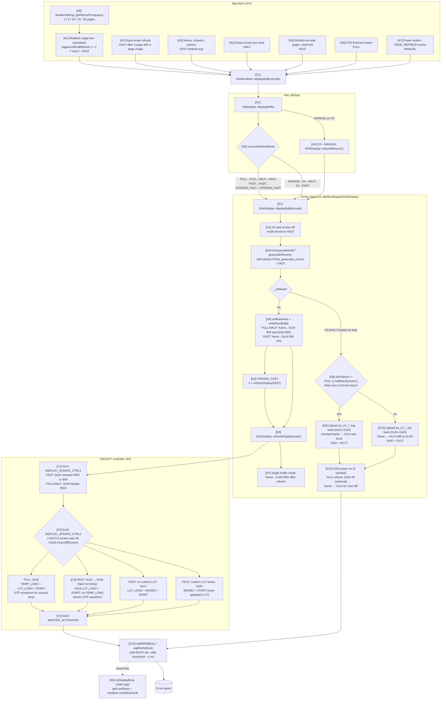
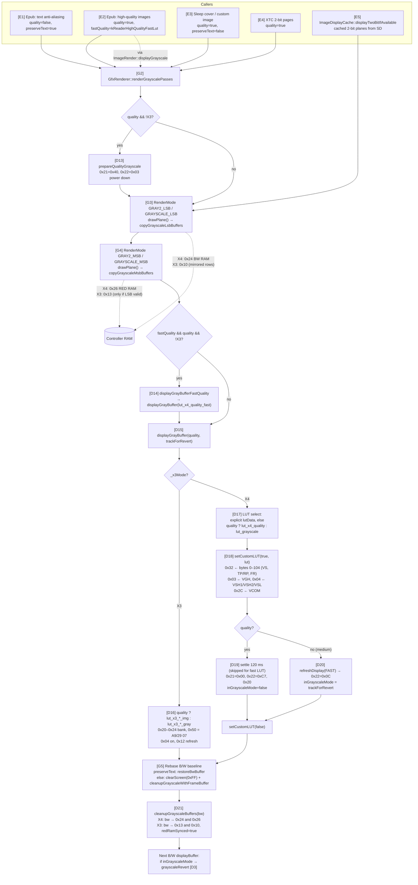
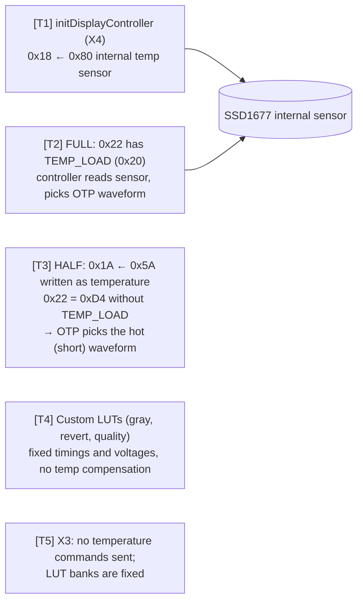

# E-ink waveform and refresh pipeline

How inx drives the panel's waveform: which code picks a refresh mode, how that mode becomes SSD1677 (X4) or X3
controller commands, where each LUT lives and gets loaded, and how temperature enters the picture.

There is no waveform file on SD or flash. Two waveform sources exist:

- **Controller OTP waveform** (X4 / SSD1677 only): selected by the controller itself when `DISPLAY_UPDATE_CTRL2`
  (`0x22`) has the `LUT_LOAD` bit set. Used for FULL, HALF and plain FAST refreshes.
- **Compiled-in LUTs** (`PROGMEM` arrays in `EInkDisplay.cpp`): pushed over SPI before a refresh. On X4 these are
  only the grayscale LUTs; on X3 every refresh uploads a full 5-register LUT bank.

Node tags like `[D3]` refer to the legend below each diagram.

## 1. Black/white update path

### Legend — diagram 1

| Tag | What | Where |
|---|---|---|
| A1 | Reader cadence: HALF when the countdown hits 1, else FAST via the default arg | `src/activity/reader/Epub/EpubActivity.cpp:2018-2026` (`displayPageBuffer` lambda), `src/activity/reader/TxtReaderActivity.cpp:440-446`, `src/activity/reader/XtcReaderActivity.cpp:736-757, 789-795, 856-862` (uses `xtcRefreshFrequency`, `src/state/ReaderSetting.h:57`) |
| A2 | `smartRefreshAfterLargeImage` forces HALF on the page after a large image | `src/activity/reader/Epub/EpubActivity.cpp:1988, 2017-2019` |
| A3 | Most UI redraws call `displayBuffer()` / `displayBuffer(HalDisplay::FAST_REFRESH)` | e.g. `src/activity/reader/Epub/MenuDrawer.cpp:382`, `src/activity/page/components/recent/HomeMenuDrawer.ipp:216`, `src/system/ScreenComponents.cpp:164` |
| A4 | White HALF pre-clear before the sleep image so the quality LUT starts from clean white | `src/activity/system/SleepActivity.cpp:294-305` |
| A5 | Optional HALF on entering Recent/Library/Settings/Sync/Stats; HALF after leaving shelf mode | `SystemSetting::runHalfRefreshOnLoadIfEnabled` `src/state/SystemSetting.cpp:574-599`; `src/activity/page/LibraryActivity.cpp:1512-1517` |
| A6 | FULL refresh once OTA finishes, to clear the long-lived progress screen | `src/activity/settings/OtaUpdateActivity.cpp:423-426` |
| A7 | Manual refresh: global short-press power and the reader's `BTN_ACTION_PAGE_REFRESH` | `handleGlobalPowerRefresh` `src/main.cpp:309-322`; `src/activity/reader/Epub/ReaderButtonBindings.cpp:131-132` |
| A8 | Maps the stored `REFRESH_FREQUENCY` enum to page counts | `ReaderSetting::getRefreshFrequency` `src/state/ReaderSetting.cpp:462-476` |
| A9 | Busy hook installed at boot; keeps input alive and runs the queued prefetch job during a refresh | `onDisplayBusy` `src/main.cpp:287-297`, `display.setBusyHook` `src/main.cpp:304`, `GfxRenderer::runRefreshJob` `lib/GfxRenderer/GfxRenderer.cpp:254` |
| G1 | Thin pass-through to the HAL | `GfxRenderer::displayBuffer` `lib/GfxRenderer/GfxRenderer.cpp:252` |
| H1–H3 | HAL adds `MANUAL_REFRESH` (not in the driver enum) and translates it per device | `lib/hal/HalDisplay.h:17`, `convertRefreshMode` / `HalDisplay::displayBuffer` `lib/hal/HalDisplay.cpp:29-57` |
| D1 | Driver entry for B/W updates | `EInkDisplay::displayBuffer` `open-x4-sdk/libs/display/EInkDisplay/src/EInkDisplay.cpp:778` |
| D2 | X4 only: first update after power-off is promoted to HALF | `EInkDisplay.cpp:779-782` |
| D3 | Leaving medium grayscale runs the revert LUT as a FAST refresh first | `grayscaleRevert` `EInkDisplay.cpp:653-664`, LUT `lut_grayscale_revert` `EInkDisplay.cpp:81-112` |
| D4 | RAM writes; firmware builds with `EINK_DISPLAY_SINGLE_BUFFER_MODE=1` so the RED (previous-frame) RAM is never rewritten before FAST | `EInkDisplay.cpp:895-910`, `platformio.ini:27, 89, 145` |
| D5 | `STRONG_FAST_REFRESH` = four FAST passes (no caller in `src/` uses it today) | `EInkDisplay.cpp:916-920` |
| D6 | Builds the `0x21`/`0x22` command bytes; on X3 it just recurses to `displayBuffer` | `EInkDisplay::refreshDisplay` `EInkDisplay.cpp:1176-1237` |
| D7 | Re-syncs RED RAM to the shown frame so the next FAST diff is correct | `EInkDisplay.cpp:925-930` |
| D8–D11 | X3 policy: full sync with image LUTs vs. differential fast with full LUTs; HALF is deliberately treated as fast | `EInkDisplay.cpp:789-893`; LUT banks `lut_x3_*_full` `:115-134`, `lut_x3_*_img` `:171-197`; `requestResync` `:212`; one initial full sync armed in `begin()` `:297` |
| D12 | BUSY-pin wait loops with 30 s timeout and hook callback | `waitForRefresh` `EInkDisplay.cpp:354-379`, `waitWhileBusy` `:408-435` |
| C1–C4 | SSD1677 update-control encoding (bit names from the driver's comment table) | `EInkDisplay.cpp:1182-1232`; command defines `:28-39` |

## 2. Grayscale / custom-LUT path

### Legend — diagram 2

| Tag | What | Where |
|---|---|---|
| E1 | Text AA second pass over a stored B/W frame | `src/activity/reader/Epub/EpubActivity.cpp:2054-2069` |
| E2 | Quality image pass with the fast quality LUT (`kReaderHighQualityFastLut = true`) | `EpubActivity.cpp:73, 2043-2053`; `ImageRender::displayGrayscale` `lib/GfxRenderer/ImageRender.cpp:237-240` |
| E3 | Sleep image quality grayscale | `src/activity/system/SleepActivity.cpp:504-512, 591-594` |
| E4 | XTC 2-bit page render | `src/activity/reader/XtcReaderActivity.cpp:764` |
| E5 | Pre-rendered 2-bit planes replayed from the SD cache; runs the same LSB/MSB/display/cleanup steps inline | `ImageDisplayCache::displayTwoBitIfAvailable` `lib/GfxRenderer/ImageDisplayCache.cpp:262-313`; entry from `ImageRender::displayCachedTwoBit` `lib/GfxRenderer/ImageRender.cpp:158` |
| G2 | Shared LSB→MSB→refresh→rebase sequence | `GfxRenderer::renderGrayscalePasses` `lib/GfxRenderer/GfxRenderer.cpp:451-486` |
| G3–G4 | Render modes `GRAYSCALE_*` (medium, `lut_grayscale`) vs `GRAY2_*` (quality); quality mid-tones are swapped by `mapQualityGray2Level` so both devices route levels to the same LUT entries | `lib/GfxRenderer/GfxRenderer.h:28`; `GfxRenderer.cpp:302-304`; `lib/GfxRenderer/BitmapUtil.cpp:169-174`; driver RAM writes `EInkDisplay.cpp:666-734` |
| G5 | Restore or blank the B/W frame after a gray refresh | `restoreBwBuffer` `GfxRenderer.cpp:402-437`, `cleanupGrayscaleWithFrameBuffer` `:444-449` |
| D13 | Powers analog down so the quality waveform starts from a known state (X4 only) | `EInkDisplay::prepareQualityGrayscale` `EInkDisplay.cpp:1121-1133` |
| D14 | Fast quality on X4; HAL routes X3 to `displayGrayBuffer(…, quality=true)` instead | `EInkDisplay.cpp:1117-1119`; `HalDisplay::displayGrayBufferFastQuality` `lib/hal/HalDisplay.cpp:77-83` |
| D15 | Gray refresh entry; HAL always passes `lutData = nullptr` | `EInkDisplay::displayGrayBuffer` `EInkDisplay.cpp:1009`; `HalDisplay::displayGrayBuffer` `lib/hal/HalDisplay.cpp:73-75` |
| D16 | X3 gray: tuned 4-level bank or the stock image bank | `EInkDisplay.cpp:1011-1085`; `lut_x3_*_gray` `:144-168`, `lut_x3_*_img` `:171-197` |
| D17 | X4 LUT choice | `EInkDisplay.cpp:1092-1093`; `lut_grayscale` `:45-79`, `lut_x4_quality` `:222-228`, `lut_x4_quality_fast` `:214-220` |
| D18 | LUT upload layout (110 bytes: 105 waveform + 5 voltages) | `EInkDisplay::setCustomLUT` `EInkDisplay.cpp:1239-1267` |
| D19–D20 | Quality fires `0xC7` directly; medium uses FAST with custom LUT (`0x0C`, no OTP load) and arms the revert | `EInkDisplay.cpp:1087-1115`; FAST custom-LUT bit choice `:1222-1223` |
| D21 | Rewrites both RAM planes from the B/W frame so the next differential update has a coherent base | `EInkDisplay::cleanupGrayscaleBuffers` `EInkDisplay.cpp:742-775` |

## 3. Temperature handling

| Tag | What | Where |
|---|---|---|
| T1 | Internal sensor selected once at controller init | `EInkDisplay.cpp:489-497` (`CMD_TEMP_SENSOR_CONTROL` `:14`) |
| T2 | FULL refresh loads temperature and the matching OTP waveform | `EInkDisplay.cpp:1215-1216` |
| T3 | HALF writes a fake high temperature to get the faster OTP waveform | `EInkDisplay.cpp:1217-1221` (`CMD_WRITE_TEMP 0x1A` `:39`) |
| T4 | All four X4 custom LUTs carry their own frame rate and VGH/VSH1/VSH2/VSL/VCOM bytes | `EInkDisplay.cpp:45-112, 214-228`, applied in `setCustomLUT` `:1249-1259` |
| T5 | X3 init and refresh paths contain no `0x18`/`0x1A`-style temperature commands | `EInkDisplay.cpp:437-484, 789-893, 1011-1085` |

## Notes

- `EInkDisplay::displayWindow`, `EInkDisplay::displayGrayBufferWindow` and `STRONG_FAST_REFRESH` exist in the
  driver but have no callers in `src/` or `lib/`.
- Power-down for sleep: `src/main.cpp:256` → `HalDisplay::deepSleep` → `EInkDisplay::deepSleep`
  (`EInkDisplay.cpp:1269-1293`: `0x22 = 0x03` if powered, then `0x10 ← 0x01`).
- `turnOffScreen` is never passed by the HAL's `displayBuffer`, so the X4 analog rails stay on between updates
  until a quality gray refresh (`0xC7` includes power-off bits), `prepareQualityGrayscale`, or `deepSleep` turns
  them off — which is what makes [D2] promote the next update to HALF.
